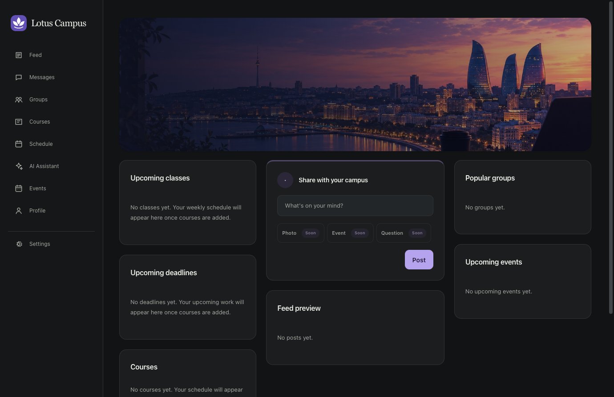
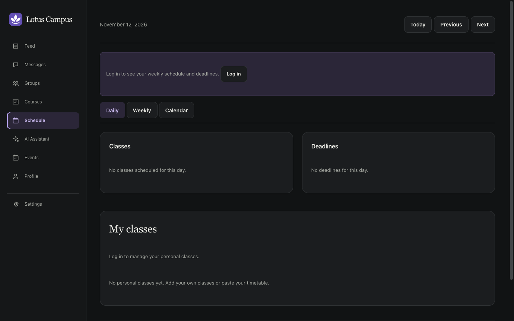
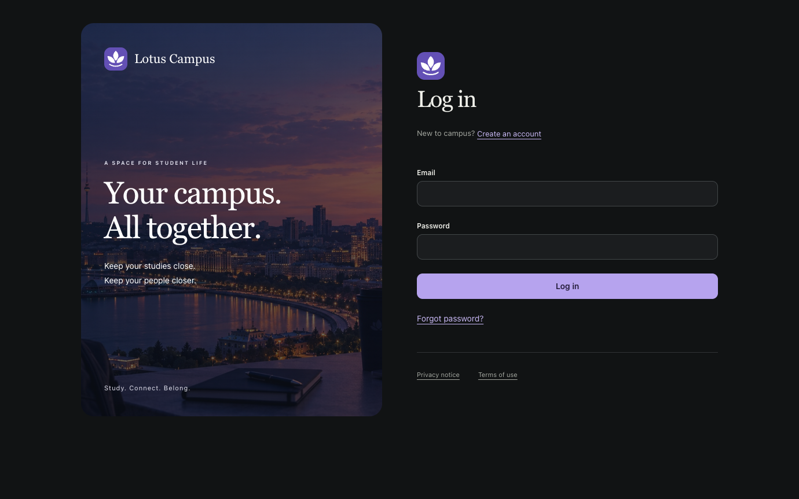
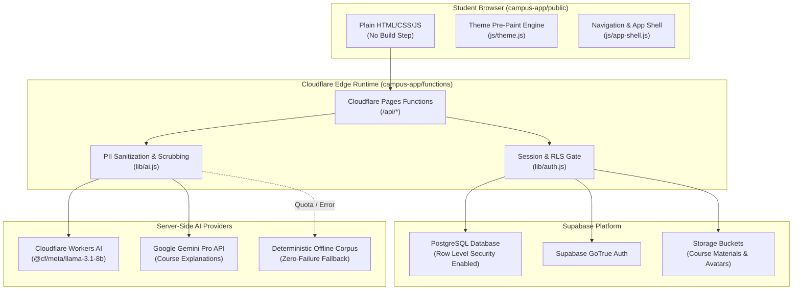

<p align="center">
  
</p>

# Lotus Campus

<p align="center">
  <strong>A focused, calm campus workspace for university students in Azerbaijan. Bringing groups, courses, schedules, events, peer messaging, and an AI study companion into one unified experience.</strong>
</p>

<p align="center">
  <a href="https://github.com/Snowstormme/Lotus"></a>
  
  
  
  
</p>

---

## Table of Contents

- [Overview](#overview)
- [Product Philosophy](#product-philosophy)
- [Core Spaces & Capabilities](#core-spaces--capabilities)
  - [1. Campus Home Dashboard](#1-campus-home-dashboard)
  - [2. Academic Schedule & Calendar](#2-academic-schedule--calendar)
  - [3. Course Catalogs & Materials](#3-course-catalogs--materials)
  - [4. University Groups & Societies](#4-university-groups--societies)
  - [5. Campus Feed & Discussions](#5-campus-feed--discussions)
  - [6. Student Peer Messaging](#6-student-peer-messaging)
  - [7. AI Study Assistant](#7-ai-study-assistant)
  - [8. Identity, Privacy & Security](#8-identity-privacy--security)
- [Supported Azerbaijani Universities](#supported-azerbaijani-universities)
- [System Architecture](#system-architecture)
- [Technology Stack](#technology-stack)
- [Repository Layout](#repository-layout)
- [Local Development & Checks](#local-development--checks)
- [Cloudflare Pages & Supabase Deployment](#cloudflare-pages--supabase-deployment)
- [Security, Privacy & Data Isolation](#security-privacy--data-isolation)
- [Contributing & Governance](#contributing--governance)

---

## Overview

Student life across Azerbaijani universities has historically been fragmented across informal Telegram channels, scattered WhatsApp group chats, disconnected PDF syllabi, and ad-hoc shared drives.

**Lotus Campus** unifies the essential academic and social journey of a university student into a single, cohesive, calm editorial workspace:
- **One academic rhythm**: Manage class timetables, upcoming assignments, and exam deadlines across daily, weekly, and monthly calendar views.
- **Verified university communities**: Discover public clubs and join university-restricted societies with strict institutional boundary checks.
- **Course directory & materials**: Access official course codes, teacher information, semester credits, and shared study materials.
- **Privacy-first student messaging**: Connect with peers, project teammates, and study partners with built-in blocking and reporting safety controls.
- **AI-powered study support**: Query study concepts and course outlines via Cloudflare Workers AI and Google Gemini with automatic local fallbacks and zero PII transmission.

All packaged in an **ultra-lightweight, zero-build-step architecture** designed to load instantly on any network.

---

## Product Philosophy

1. **One Calm Workspace, Not a Fragmented App**: Every core student need lives under one consistent navigation model with zero context switching.
2. **Campus Editorial Aesthetic**: Typography inspired by academic journals, Georgia display headings, system body fonts, restrained violet accents (`#7c5cff`), and warm surfaces that feel like paper in light mode and deep slate in dark mode.
3. **Strict Data Hygiene & Privacy**: No personal identifiers (names, emails, student IDs) are ever sent to external LLMs. Only sanitized course titles and academic dates are processed.
4. **Resilient Offline & Graceful Fallbacks**: If external AI or network endpoints fluctuate, saved offline fallbacks ensure students can always access their course outlines, class schedules, and deadlines.
5. **Intentional Product Scope**: The platform strictly avoids administrative bloat. It does **not** duplicate official university grading systems, mandatory attendance tracking, or full digital library archives.

---

## Core Spaces & Capabilities

### 1. Campus Home Dashboard

The central command hub of daily student life. Features a full-width Baku waterfront masthead and a clean multi-column layout aggregating classes, imminent deadlines, active societies, and campus announcements.

<p align="center">
  
</p>

- **Upcoming Classes Shelf**: Instant view of your next lectures, room numbers, campus buildings, and instructors.
- **Deadlines Tracker**: Visual urgency indicators for problem sets, term papers, and project milestones.
- **Campus Share Composer**: Post updates, announcements, questions, or event notices to your peers.
- **Feed & Societies Previews**: Quick glance at active campus discussions and upcoming student association gatherings.

---

### 2. Academic Schedule & Calendar

A multi-view scheduling engine designed specifically for Azerbaijani academic semesters and Baku local time (`Asia/Baku`).

<p align="center">
  
</p>

- **Three Adaptive Views**: Toggle between **Daily** timetable, **Weekly** overview, and **Monthly** calendar.
- **Personal Classes & Timetable Import**: Add custom recitations, lab sessions, and study group meetings alongside official registered courses.
- **Baku Midnight Rollover**: Verified date calculations accurately account for semester schedules in Azerbaijan's timezone without UTC off-by-one errors.

---

### 3. Course Catalogs & Materials

A structured academic directory cataloging hundreds of real courses across major Azerbaijani universities.

- **Verified Course Metadata**: Official course codes (e.g. `CS 201`, `ECON 101`), ECTS credits, department/faculty affiliations, and instructor names.
- **Course Detail Spaces**: Centralized space for syllabus overviews, required readings, lecture slides, and student discussions.
- **Quick Search & Filter**: Search courses instantly by course code, title keyword, instructor name, or classroom number.

---

### 4. University Groups & Societies

Connect with student societies, debate clubs, hackathon teams, and faculty study circles.

- **Institutional Boundary Protection**: Public discovery allows browsing clubs across campuses, while university-restricted groups enforce verified institutional email checks before granting access.
- **Group Activity & Discussions**: Dedicated group feeds, member directories, and announcements.
- **Club Management**: Simple, intuitive join and leave flows with real-time membership counts.

---

### 5. Campus Feed & Discussions

A clean, distraction-free campus feed for student discourse, academic queries, and university life.

- **Author Affiliation Badges**: Transparent identification of student university and faculty affiliations.
- **Rich Post Content**: Announcements, questions, and study tips with structured text formatting.
- **Civic Safety Controls**: Community-moderated reporting mechanisms and safety flagging.

---

### 6. Student Peer Messaging

Fast, private 1-on-1 messaging for project coordination and peer communication.

- **Divided Workspace Layout**: Split-pane desktop conversation list with initials avatars and unread indicators.
- **Safety First**: Full user blocking, mute notifications, and conversation deletion controls.
- **Zero Third-Party Trackers**: Direct websocket/REST messaging without commercial analytics trackers.

---

### 7. AI Study Assistant

An integrated academic companion designed to help explain complex lecture topics, summarize study notes, and break down syllabus milestones.

- **Dual LLM Architecture**: Backed by **Cloudflare Workers AI** (`@cf/meta/llama-3.1-8b-instruct-fp8`) on edge and **Google Gemini** through secure server-side functions.
- **Zero PII Leakage**: Client personal identities are strictly scrubbed before prompt submission. Prompts include only relevant course titles and study queries.
- **Deterministic Offline Fallback**: If LLM quotas are exhausted or offline, pre-indexed course guidelines ensure the assistant never returns a dead screen.

---

### 8. Identity, Privacy & Security

A refined, accessible onboarding and authentication experience designed around student dignity and privacy.

<p align="center">
  
</p>

- **Split-Screen Editorial Login**: Immersive visual panel paired with clean, accessible input fields meeting 44px tap targets.
- **Strict Row Level Security (RLS)**: Enforced directly at the Postgres database layer. No user can read or modify private data belonging to another student.
- **Theme Synchronization**: Automatic pre-paint theme engine (`js/theme.js`) prevents dark-mode flash and synchronizes preferences across browser tabs via `storage` events.

---

## Supported Azerbaijani Universities

Lotus Campus incorporates verified academic curricula, faculty structures, and official logos across institutions:

| University | Abbreviation | City | Official Catalog Scope |
| :--- | :---: | :---: | :--- |
| **ADA University** | ADA | Baku | School of IT & Engineering, School of Public & International Affairs |
| **Bakı Dövlət Universiteti** | BDU | Baku | Applied Mathematics & Cybernetics, Mechanics & Mathematics, Philology |
| **Azərbaycan Dövlət İqtisad Universiteti** | UNEC | Baku | Economics, International Economics, Finance & Accounting |
| **Azərbaycan Dövlət Neft və Sənaye Universiteti** | ASOIU | Baku | Instrumentation Engineering, Information Technologies & Control |
| **Bakı Ali Neft Məktəbi** | BHOS | Baku | Computer Engineering, Chemical Engineering, Petroleum Engineering |
| **Bakı Mühəndislik Universiteti** | BMU | Khirdalan | Computer Engineering, Information Technologies, Mechanical Engineering |
| **Xəzər Universiteti** | Khazar | Baku | Mathematics & Computer Education, Engineering & Applied Sciences |
| **Azərbaycan Memarlıq və İnşaat Universiteti** | AzUAC | Baku | Construction Economics, Architecture, Civil Engineering |
| **Azərbaycan Tibb Universiteti** | AMU | Baku | General Medicine, Nursing, Dentistry |
| **Azərbaycan Dövlət Pedaqoji Universiteti** | ADPU | Baku | Philology, Mathematics & Informatics, History & Geography |
| **Sumqayıt Dövlət Universiteti** | SDU | Sumqayit | History & Geography, Information Technologies |
| **Gəncə Dövlət Universiteti** | GDU | Ganja | Philology & Foreign Languages, Natural Sciences |

---

## System Architecture



---

## Technology Stack

| Layer | Technology | Purpose |
| :--- | :--- | :--- |
| **Frontend** | Vanilla ES6+ JavaScript, Semantic HTML5, Modular CSS | Zero build step, instant deployment, sub-50ms paint times |
| **Styling & Theme** | CSS Custom Properties, Georgia Serif & System Sans | Academic editorial feel, automatic OS dark/light sync |
| **Edge Compute** | Cloudflare Pages Functions | Serverless API endpoints running within milliseconds of Baku users |
| **Database** | PostgreSQL via Supabase | Relational data integrity, schema migrations, foreign keys |
| **Security & Auth** | Supabase Auth + Postgres Row Level Security (RLS) | Database-level authorization; service-role keys restricted to server |
| **AI Inference** | Cloudflare Workers AI (`llama-3.1-8b`) & Google Gemini | Server-side study queries with strict PII filtering |
| **Test Suite** | Plain Node.js Test Harness (`scripts/test-*.js`) | Zero external test dependencies; sub-second verification |

---

## Repository Layout

```text
Lotus/
├── README.md                  # Primary repository documentation
├── docs/                      # Architectural assets and audit reports
│   └── screenshots/           # High-resolution application screenshots
│       ├── lotus-home-dashboard.png
│       ├── lotus-auth-screen.png
│       ├── lotus-schedule.png
│       ├── lotus-courses.png
│       └── lotus-groups.png
└── campus-app/                # Complete web application package
    ├── package.json           # Node engine and metadata
    ├── wrangler.toml          # Cloudflare Pages Functions configuration
    ├── AGENTS.md              # Architectural rules and scope boundaries
    ├── public/                # Static client bundle (deployed to Cloudflare Pages)
    │   ├── index.html         # Campus Home Dashboard
    │   ├── schedule.html      # Daily/Weekly/Monthly calendar views
    │   ├── courses.html       # University course directory
    │   ├── course.html        # Course detail & materials page
    │   ├── groups.html        # University societies & clubs
    │   ├── feed.html          # Campus feed & discussions
    │   ├── messages.html      # Peer messaging workspace
    │   ├── assistant.html     # AI Study Assistant interface
    │   ├── profile.html       # Student profile & academic affiliation
    │   ├── settings.html      # Theme, privacy & account settings
    │   ├── login.html         # Split-screen student authentication
    │   ├── signup.html        # Account registration
    │   ├── onboarding.html    # University & faculty selection flow
    │   ├── style.css          # Design system & semantic tokens
    │   ├── js/                # Modular client-side controllers
    │   └── img/               # Brand SVGs and university emblems
    ├── functions/api/         # Cloudflare Pages Functions HTTP endpoints
    │   ├── calendar.js        # Schedule and class queries
    │   ├── courses.js         # Course catalog and registration
    │   ├── deadlines.js       # Assignment deadlines tracking
    │   ├── groups.js          # Club discovery and membership
    │   ├── posts.js           # Campus feed posts and reactions
    │   ├── assistant.js       # Server-side AI study assistant proxy
    │   ├── profile.js         # User profile and university metadata
    │   └── config.js          # Safe public configuration endpoint
    ├── lib/                   # Shared server-side database and AI helpers
    ├── supabase/
    │   └── schema.sql         # Postgres DDL schema, tables & RLS policies
    └── scripts/               # Test runners and catalog SQL generators
        ├── test-catalog.js    # University catalog regression verification
        ├── test-dates.js      # Baku timezone rollover verification
        ├── test-groups.js     # Institutional access control tests
        ├── test-loading.js    # Resilience and retry checks
        ├── test-plan.js       # Study schedule validator tests
        ├── test-settings.js   # User preference persistence tests
        ├── test-theme.js      # Theme sync and pre-paint tests
        ├── test-ui.js         # DOM sanitation and UI namespace tests
        └── catalog/           # Multi-batch curriculum SQL generators
```

---

## Local Development & Checks

### Prerequisites
- [Node.js](https://nodejs.org/) v18 or higher.
- Any local static HTTP server (e.g. `npx serve`, Python `http.server`, or Node).

### 1. Serve Static Frontend
To preview the client interface locally:

```sh
cd campus-app/public
npx serve .
# Open http://localhost:3000
```

### 2. Run Test Suite
Lotus Campus includes a zero-dependency automated test harness in `campus-app/scripts/`. Run the full verification suite directly with Node:

```sh
cd campus-app

# 1. Verify university catalog data integrity & batch regressions
node scripts/test-catalog.js

# 2. Verify Baku timezone calculations and date rollovers
node scripts/test-dates.js

# 3. Verify institutional group access boundaries and permissions
node scripts/test-groups.js

# 4. Verify theme synchronization and pre-paint engine
node scripts/test-theme.js

# 5. Verify DOM construction and SVG namespace safety
node scripts/test-ui.js

# 6. Verify client resilience, storage fallbacks, and error boundaries
node scripts/test-loading.js

# 7. Verify user preference updates and rollbacks
node scripts/test-settings.js

# 8. Check syntax of all frontend and function scripts
node --check public/app.js public/js/*.js functions/api/*.js
```

---

## Cloudflare Pages & Supabase Deployment

### 1. Database Setup (Supabase)
1. Create a new project in the [Supabase Dashboard](https://supabase.com).
2. Open the **SQL Editor**.
3. Paste the contents of [`campus-app/supabase/schema.sql`](file:///Users/me/Projects/python/Lotus/campus-app/supabase/schema.sql) and execute.
4. This initializes tables (`universities`, `faculties`, `courses`, `groups`, `posts`, `deadlines`), enables Row Level Security (RLS), and seeds baseline data.

### 2. Edge Deployment (Cloudflare Pages)
1. Push your repository to GitHub.
2. In the [Cloudflare Dashboard](https://dash.cloudflare.com/), navigate to **Compute (Workers) > Pages > Connect to Git**.
3. Select your `Lotus` repository and configure the build settings:
   - **Framework preset**: None
   - **Build command**: *(leave empty)*
   - **Build output directory**: `campus-app/public`
4. Under **Settings > Environment variables**, add:
   - `SUPABASE_URL`: Your Supabase Project URL (`https://<project>.supabase.co`).
   - `SUPABASE_PUBLISHABLE_KEY`: Your Supabase Anon/Public Key.
   - `SUPABASE_SERVICE_ROLE_KEY`: Your Supabase Service Role Key *(kept private to Pages Functions)*.
   - `GEMINI_API_KEY`: Google Gemini API Key *(used only server-side)*.
5. Under **Settings > Functions > Workers AI Bindings**, add:
   - Binding name: `AI`

---

## Security, Privacy & Data Isolation

- **Row Level Security (RLS)**: Enforced directly inside PostgreSQL. Public users and authenticated students can only access records permitted by explicit database security policies.
- **Zero Client-Side Secrets**: Neither `SUPABASE_SERVICE_ROLE_KEY`, `GEMINI_API_KEY`, nor internal tokens ever reach client JavaScript. The only public credential exposed is the publishable anon key via `/api/config`.
- **Zero PII to Language Models**: When students consult the AI Study Assistant, all personally identifiable information (PII) is stripped server-side prior to prompt dispatch.
- **Institutional Join Verification**: Students can only join private university groups matching their authenticated institutional domain or verified enrollment records.

---

## Contributing & Governance

Lotus Campus is an open, community-oriented initiative for university students in Azerbaijan.

1. **Keep Changes Small**: One focused improvement per pull request.
2. **Honor Product Scope**: Do not build administrative gradebooks, biometric attendance, or duplicate university registrar portals.
3. **Verify Tests**: All tests in `campus-app/scripts/` must pass cleanly before opening a pull request.
4. **No Frontend Build Steps**: Keep HTML, CSS, and JS vanilla, modular, and dependency-free.

---

<p align="center">
  <sub>Crafted for university students across Azerbaijan. Distributed under the MIT License.</sub>
</p>
